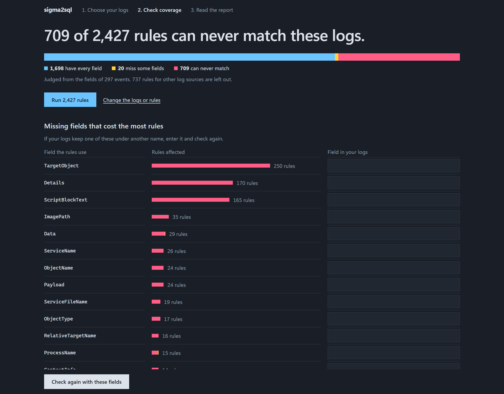
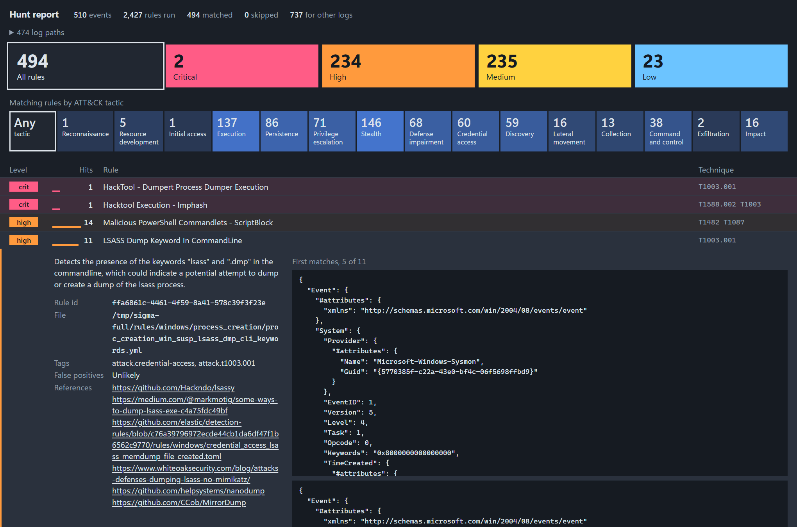

# sigma2sql

[](https://github.com/brkozer/sigma2sql/actions/workflows/ci.yml)
[](https://pypi.org/project/sigma2sql/)


Run [Sigma](https://sigmahq.io) detection rules where your logs already are: a folder of
`.evtx` files, or a PostgreSQL, ClickHouse, DuckDB or SQLite database. No SIEM, no server to
set up, and it tells you which of your rules can never fire.

<p align="center"></p>

## What it does

**Hunt through logs.** Run thousands of rules over EVTX, JSON, CSV or Parquet files, or
directly in your database over a read-only connection. You get the matches, most severe first,
and a one-file HTML report to hand over.

```bash
sigma2sql hunt sigma/rules --logs 'incident/*.evtx' --html report.html
```

**Find your blind spots.** A rule that needs a field your logs do not have never fires, and
nothing tells you. `coverage` lists those rules and the missing fields that cost the most.

```bash
sigma2sql coverage sigma/rules --logs 'incident/*.evtx'
```

**Turn rules into SQL.** Convert rules for your own table and schema, ready to schedule or put
in a view. Correlations such as "three failed logons in five minutes" become SQL too.

```bash
sigma2sql convert sigma/rules -d postgres -t security.events --json-column event -p ecs-winlogbeat
```

**Test rules before they ship.** Put example events next to each rule and let CI check that
it still fires on what it should, and only on that.

```yaml
- uses: brkozer/sigma2sql@v0.5.2
  with:
    path: rules
```

**Or do all of it from a page.** `sigma2sql serve` opens a page on your own machine: choose the
logs, see the coverage, map the fields your logs call something else, run the rules and read
the report.

## Why you can trust the results

- **All of SigmaHQ runs.** The 3,807 rules in its five rule folders convert and execute on
  SQLite, DuckDB and ClickHouse, and 3,804 on PostgreSQL, checked against every database in CI
  each week.
- **Checked on real events.** All 477 of SigmaHQ's regression samples, real Windows events
  with a known result, match as expected on SQLite, DuckDB, ClickHouse and straight from the
  `.evtx` files.
- **Same answers as the reference.** On those events sigma2sql agrees with pySigma on 3,076 of
  3,078 rules. The two differences are IPv6 addresses pySigma's text matching misses.
- **A database gives the same matches as the files.** On SQLite, DuckDB and ClickHouse the
  results are identical rule for rule; PostgreSQL leaves out the 2 rules it cannot run.

[How it is checked](https://brkozer.github.io/sigma2sql/correctness/) has the method.

## Get started

```bash
pip install "sigma2sql[duckdb,evtx]"     # add ,postgres to hunt in PostgreSQL
git clone --depth 1 https://github.com/SigmaHQ/sigma
sigma2sql hunt sigma/rules --logs 'logs/*.evtx'
```

`convert`, `test` and `check` need nothing beyond the base package. Python 3.12 or newer.

<p align="center"></p>

## Documentation

Everything is at **[brkozer.github.io/sigma2sql](https://brkozer.github.io/sigma2sql/)**:

- [Quick start](https://brkozer.github.io/sigma2sql/quickstart/)
- [Hunt through log files](https://brkozer.github.io/sigma2sql/hunt/) and
  [in a database](https://brkozer.github.io/sigma2sql/database/)
- [Rule coverage](https://brkozer.github.io/sigma2sql/coverage/) and the
  [local interface](https://brkozer.github.io/sigma2sql/serve/)
- [Convert rules](https://brkozer.github.io/sigma2sql/convert/),
  [correlations](https://brkozer.github.io/sigma2sql/correlations/),
  [profiles](https://brkozer.github.io/sigma2sql/profiles/),
  [placeholders](https://brkozer.github.io/sigma2sql/placeholders/) and
  [filters](https://brkozer.github.io/sigma2sql/filters/)
- [Test rules and the GitHub Action](https://brkozer.github.io/sigma2sql/testing/)
- [Supported Sigma features](https://brkozer.github.io/sigma2sql/features/), the
  [command line](https://brkozer.github.io/sigma2sql/cli/) and
  [library use](https://brkozer.github.io/sigma2sql/library/)
- [How it works](https://brkozer.github.io/sigma2sql/how-it-works/), including development

## License

MIT
