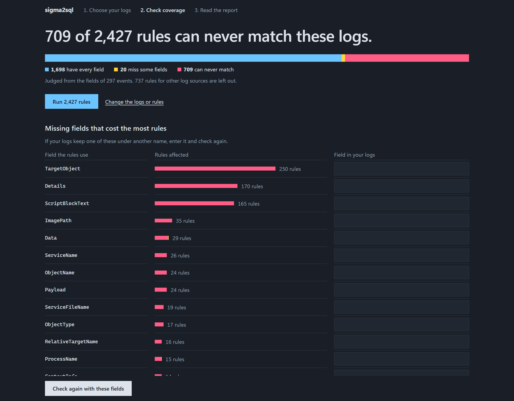
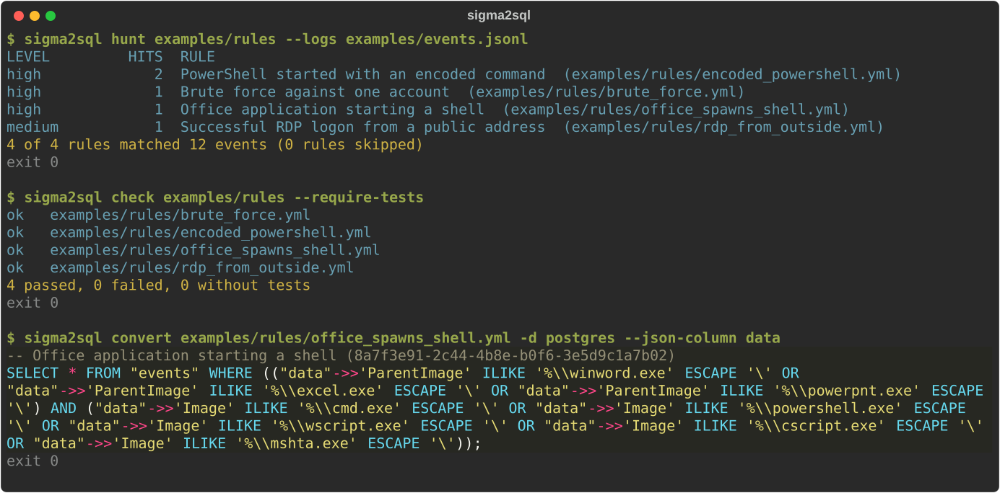

# sigma2sql

Run [Sigma](https://sigmahq.io) detection rules as SQL on SQLite, PostgreSQL, DuckDB and
ClickHouse.

sigma2sql hunts through log files, `.evtx` included, without a SIEM, or in a database over a
read-only connection. It shows which of your rules can match your logs at all. It converts
rules for the database your logs already live in, and tests them against example events before
they reach production. Correlations become SQL too. All of it also works from a page on your
own machine.

- **[Quick start](quickstart.md)**: install it, then run a first hunt, convert and rule test.
- **[Hunt through log files](hunt.md)**: log formats, `.evtx`, HTML reports and exit codes.
- **[Hunt in a database](database.md)**: rules on PostgreSQL, ClickHouse, SQLite or DuckDB,
  read-only.
- **[Rule coverage](coverage.md)**: which rules can never match, and the missing fields that
  cost the most.
- **[Local interface](serve.md)**: the same work from a page on this machine.
- **[Convert rules](convert.md)**: SQL for your database, your table and your columns.
- **[Profiles](profiles.md)**: map Sigma fields to your schema and limit rules by log source.
- **[Test rules](testing.md)**: example events next to each rule, and a GitHub Action.
- **[How it is checked](correctness.md)**: what was measured, and how.

## Who it is for

- **Incident responders** with a folder of `.evtx` or JSON logs and no SIEM to load them into.
  `hunt` needs no server. Damaged `.evtx` files are read as far as possible. The results
  can go to [one HTML page](hunt.md#-html) that needs no network and runs no script.
- **Detection engineers** who want rule tests in CI: `check` runs each rule against its
  example events and can write SARIF for code scanning.
- **Anyone with logs in a database**: the generated SQL is a normal query you can run, schedule
  or put in a view. A [profile](profiles.md) adapts it to your columns or nested JSON.

## From the command line

The page above is [`sigma2sql serve`](serve.md). Everything it does is also a command. Here they
run on the four example rules and the small event file in the repository:

The brute force rule is a [correlation](correlations.md): three failed logons for one account
within five minutes. It runs as SQL like the others. The same rules also
[convert](convert.md) to a query for any of the four databases.

## Measured results

All figures are against SigmaHQ `52f81d6` (2026-11-05). The method is on
[How it is checked](correctness.md).

| Check | Result |
| --- | --- |
| SigmaHQ rules in its five rule folders, converted and executed | 3807 of 3807 on SQLite, DuckDB and ClickHouse, 3804 of 3807 on PostgreSQL |
| `count()` aggregation rules kept outside those folders | all 45 convert |
| SigmaHQ regression samples (real events) | 477 of 477 on SQLite, DuckDB and ClickHouse, and from the `.evtx` files through `hunt` |
| Same results as pySigma, every rule against every sample | 3076 of 3078 rules |
| Filters compared with pySigma's `SigmaFilter` | 96 of 96 combinations |

The two pySigma differences are IPv6 addresses that its text matching misses. The three
PostgreSQL gaps are rules whose regular expressions repeat a group more than 255 times, which
PostgreSQL rejects. sigma2sql reports those rules as unsupported and leaves the pattern alone.
27 of the 3807 rules use the `expand` modifier and need [your values](placeholders.md); they
were measured with a generated file. Every generated query is executed on all four databases
in CI each week.

## Limits

- `temporal` correlations cannot have a boolean condition. See
  [Supported features](features.md).
- A rule that cannot be converted is skipped and named on stderr. A few modifier combinations
  are [ignored without a report](features.md#how-it-is-reported).
- `hunt` over files uses DuckDB, so RE2 applies there: patterns with lookaround or
  backreferences are skipped.

sigma2sql is MIT licensed. The source is at
[github.com/brkozer/sigma2sql](https://github.com/brkozer/sigma2sql).
